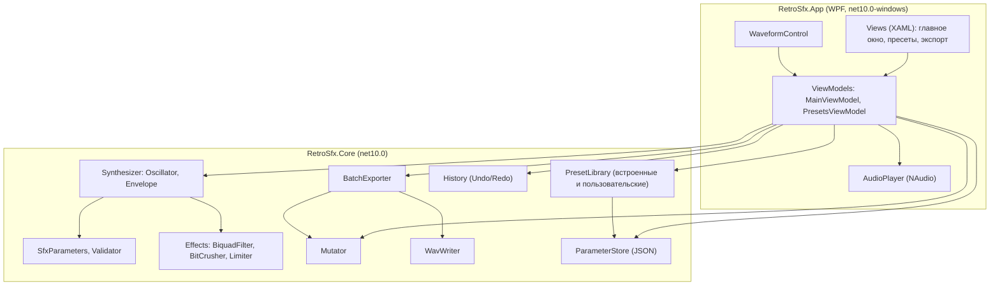
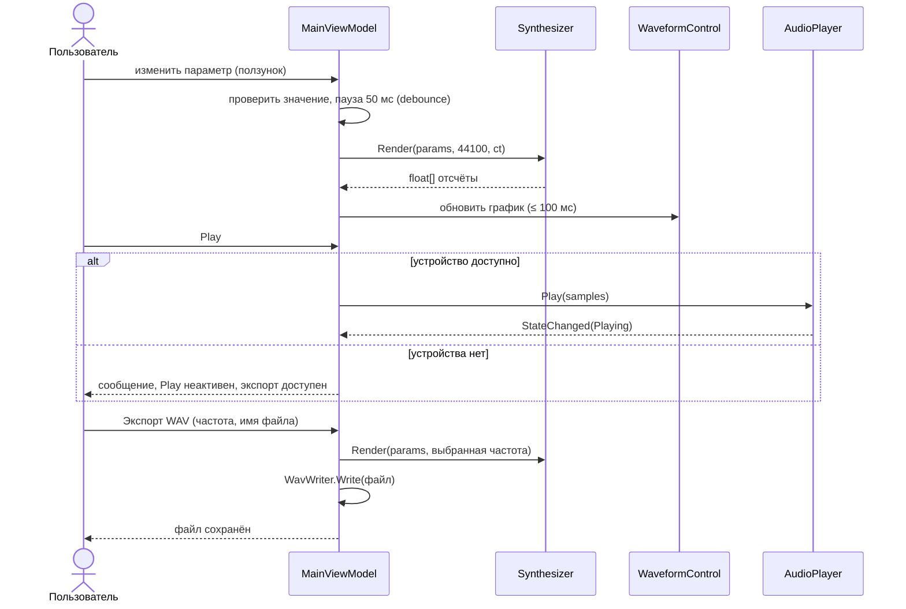
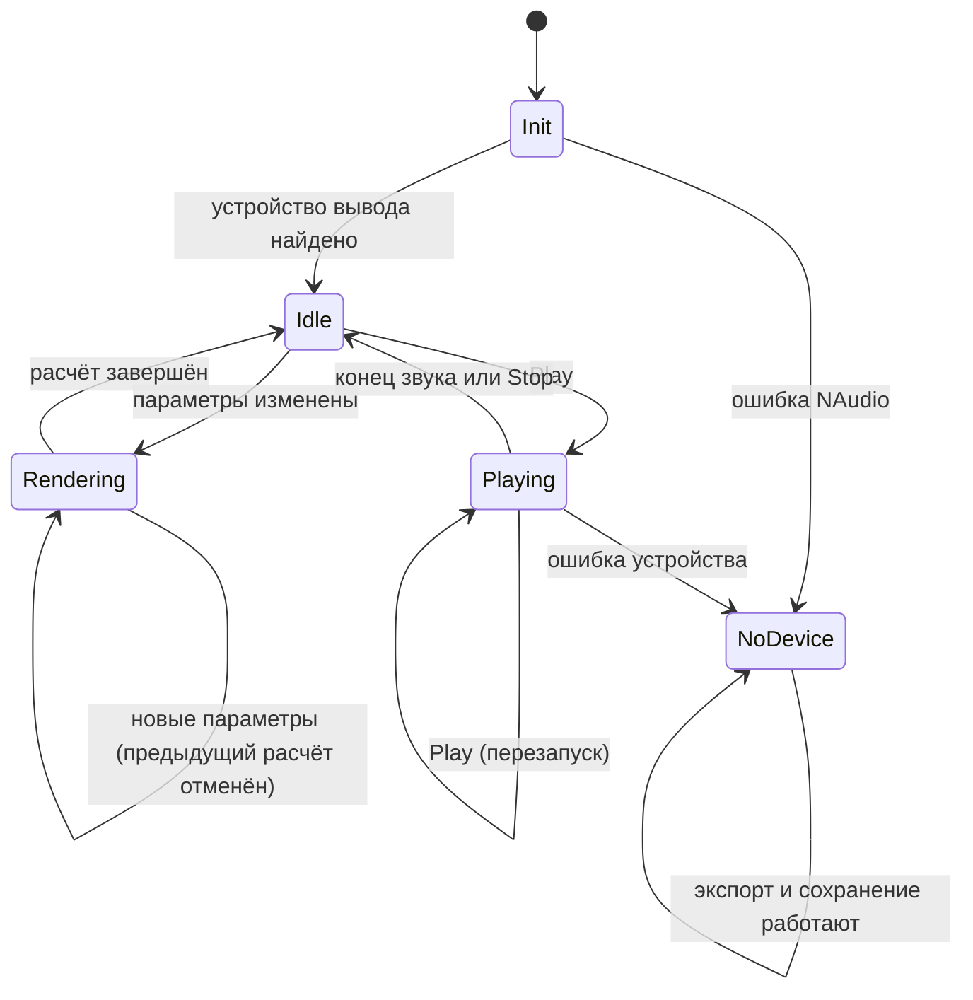

# Описание дизайна программного обеспечения

Для Retro SFX Lab — десктопного генератора звуковых эффектов в стиле 8-bit

Версия 0.2

Подготовил Мистюкович Дмитрий Витальевич

Белорусский государственный университет информатики и радиоэлектроники, кафедра ЭВМ

2026-11-16

## Оглавление

* [1. Введение](#1-введение)
  * [1.1 Назначение документа](#11-назначение-документа)
  * [1.2 Область применения](#12-область-применения)
  * [1.3 Определения, акронимы и сокращения](#13-определения-акронимы-и-сокращения)
  * [1.4 Ссылки](#14-ссылки)
  * [1.5 Обзор документа](#15-обзор-документа)
* [2. Обзор дизайна](#2-обзор-дизайна)
  * [2.1 Задачи стейкхолдеров](#21-задачи-стейкхолдеров)
  * [2.2 Выбранные точки зрения](#22-выбранные-точки-зрения)
* [3. Проектные представления](#3-проектные-представления)
* [4. Решения](#4-решения)
* [5. Приложения](#5-приложения)
  * [5.1 Priority scale](#51-priority-scale)
  * [5.2 System requirements](#52-system-requirements)
  * [5.3 Трассируемость SRS → системные требования](#53-трассируемость-srs--системные-требования)
  * [5.4 План реализации по итерациям](#54-план-реализации-по-итерациям)
  * [5.5 Открытые вопросы](#55-открытые-вопросы)

## История изменений

| Name            | Date       | Reason For Changes                                                                                                                                                                                         | Version |
|-----------------|------------|------------------------------------------------------------------------------------------------------------------------------------------------------------------------------------------------------------|---------|
| Мистюкович Д.В. | 2026-11-15 | Первая версия SDD на основе SRS 0.2: 13 проектных представлений, 27 системных требований, 7 ADR                                                                                                            | 0.1     |
| Мистюкович Д.В. | 2026-11-16 | Изменения по итогам двух раундов обсуждения с заказчиком: приоритеты пересмотрены, добавлены SYS-FUNC-014…016 (ADSR, пользовательские пресеты, экспорт вариаций), обновлены представления 003, 004, 005, 007, ADR-0005; платформа уточнена с .NET 8 на .NET 10 LTS (ADR-0001) | 0.2     |

---

## 1. Введение

Документ описывает проектное решение для приложения Retro SFX Lab: из каких частей оно состоит, как они взаимодействуют и почему выбраны именно такие технические решения.

### 1.1 Назначение документа

SDD отвечает на вопрос **КАК** будут реализованы требования SRS ([docs/srs/srs.md](../srs/srs.md), версия 0.3). Документ предназначен для разработчиков (исполнитель и junior-разработчик), заказчика и преподавателя: по нему ведётся реализация, оценка трудоёмкости и проверка трассируемости «бизнес-цель → требование SRS → системное требование → проектное представление».

### 1.2 Область применения

Проектируется Retro SFX Lab версии 1.0 — автономное настольное приложение для Windows 10/11 (x64) на C# (.NET 10) и WPF. Оно синтезирует 8-bit звуки по параметрам (5 форм волны, Slide, Vibrato, огибающая ADSR, фильтры, Bitcrush), даёт воспроизведение и график формы волны, работает с пресетами, сохраняет параметры в JSON и экспортирует звук в WAV (PCM, моно, 16 бит). Дизайн реализует бизнес-цели BG-1…BG-4 из SRS: быстрый результат (не более 3 кликов до WAV), понятные параметры, совместимость с Unity и Godot, повторяемость результата.

Вне области: экспорт в MP3/OGG, стерео, запись с микрофона, секвенсор, кроссплатформенность.

### 1.3 Определения, акронимы и сокращения

| Term         | Definition                                                                                          |
|--------------|-----------------------------------------------------------------------------------------------------|
| ADR          | Architecture Decision Record — протокол архитектурного решения                                      |
| ADSR         | Attack, Decay, Sustain, Release — огибающая громкости звука                                         |
| Biquad       | Рекурсивный фильтр второго порядка (12 дБ/октаву)                                                   |
| Bitcrush     | Эффект снижения разрядности звука                                                                   |
| DSP          | Digital Signal Processing — цифровая обработка сигналов                                             |
| MADR         | Markdown Architecture Decision Record — формат ADR                                                  |
| MVVM         | Model–View–ViewModel — шаблон построения интерфейса                                                 |
| NAudio       | Библиотека .NET для работы с аудио в Windows                                                        |
| PCM          | Импульсно-кодовая модуляция (несжатый звук)                                                         |
| SDD          | Software Design Description — описание дизайна ПО                                                   |
| SRS          | Software Requirements Specification — спецификация требований к ПО                                  |
| Seed         | Начальное число генератора случайных чисел, обеспечивает воспроизводимость                          |
| WAV          | Формат аудиофайла RIFF/WAVE                                                                         |
| WPF          | Windows Presentation Foundation                                                                     |
| Пресет       | Готовый набор параметров для типового игрового звука                                                |

### 1.4 Ссылки

- [docs/srs/srs.md](../srs/srs.md) — SRS Retro SFX Lab, версия 0.3.
- [docs/adr](../adr/) — протоколы архитектурных решений ADR-0001 … ADR-0007.
- Шаблоны `sdd/sdd-template.md`, `sdd/view-template.md`, `adr/adr-template.md` репозитория SDLC.
- ISO/IEC/IEEE 42010 — описание архитектуры; ISO/IEC/IEEE 29148 — требования.
- Microsoft Learn: WPF, .NET 10; документация NAudio; описание формата WAV (RIFF/WAVE).
- R. Bristow-Johnson, «Audio EQ Cookbook» — коэффициенты biquad-фильтров.

### 1.5 Обзор документа

Раздел 2 описывает подход и задачи стейкхолдеров, раздел 3 содержит 13 проектных представлений (идентификаторы `001-…` — `013-…`), раздел 4 — реестр решений со ссылками на ADR, раздел 5 — приложения: шкала приоритетов, системные требования (на английском языке, приоритеты 10–50), матрица трассируемости, план по итерациям и открытые вопросы. Идентификаторы требований SRS имеют вид `REQ-…`, системных — `SYS-FUNC-NNN` и `SYS-NFR-NNN`.

---

## 2. Обзор дизайна

Приложение состоит из двух проектов: библиотеки `RetroSfx.Core` (синтез, эффекты, пресеты, кодирование WAV, сериализация, история) и WPF-приложения `RetroSfx.App` (интерфейс по шаблону MVVM, график, воспроизведение через NAudio). Библиотека Core не зависит ни от WPF, ни от NAudio, поэтому тестируется отдельно и может быть подключена к Unity и Godot (ADR-0002). Весь звук считается собственным DSP-кодом (ADR-0003): это даёт побайтную воспроизводимость. Тяжёлые расчёты выполняются вне потока интерфейса (ADR-0006).

### 2.1 Задачи стейкхолдеров

| ID | Задача                                                                                         | Стейкхолдер                          | Адресуется представлениями |
|----|------------------------------------------------------------------------------------------------|--------------------------------------|----------------------------|
| C1 | Быстро получить нужный звук: выбрать пресет, подстроить, услышать, сохранить WAV за ≤ 3 клика  | Разработчик игры                     | 001, 005, 006, 007         |
| C2 | Тонкая настройка и воспроизводимость: одинаковые параметры и seed дают одинаковый файл         | Дизайнер звука                       | 004, 007, 010              |
| C3 | Отзывчивый интерфейс: график ≤ 100 мс, синтез 1 с ≤ 100 мс, экспорт 5 с ≤ 500 мс               | Разработчик игры, дизайнер звука     | 006, 009, 010              |
| C4 | Устойчивость к повреждённым файлам и отсутствию звукового устройства                           | Все пользователи                     | 004, 005, 008              |
| C5 | Совместимость WAV с Unity, Godot и сторонними редакторами                                      | Разработчик игры                     | 003, 005, 007              |
| C6 | Сопровождаемость и тестируемость: чёткая граница между интерфейсом и ядром                     | Разработчик, сопровождающий          | 002, 003, 011, 013         |
| C7 | Простая сборка и поставка; автономная работа без интернета                                     | Пользователь, сопровождающий         | 001, 012                   |
| C8 | Прослеживаемость: каждое требование SRS покрыто дизайном и обосновано                          | Заказчик, преподаватель              | все представления, 4 и 5   |

### 2.2 Выбранные точки зрения

Выбраны 13 точек зрения из 15 возможных. Не выбраны **Physical** (у проекта нет собственной аппаратной инфраструктуры, приложение работает на обычном ПК) и **Structure** (внутренняя организация компонентов достаточно описана в представлениях Composition и Logical).

| Точка зрения   | Проектное представление | Зачем выбрана                                                         |
|----------------|-------------------------|-----------------------------------------------------------------------|
| Контекст       | 001-context             | Границы системы, акторы и внешняя среда (C1, C7)                      |
| Композиция     | 002-composition         | Разбиение на проекты и компоненты (C6)                                |
| Логическое     | 003-logical             | Основные типы ядра и их связи (C5, C6)                                |
| Информация     | 004-information         | JSON-файлы, формат параметров и пресетов (C2, C4)                     |
| Интерфейс      | 005-interface           | Контракты между Core и App (C1, C4, C5)                               |
| Взаимодействие | 006-interaction         | Сценарии «изменить параметр → услышать» и «экспорт» (C1, C3)          |
| Алгоритм       | 007-algorithm           | Конвейер синтеза, формулы, детерминизм (C2, C5)                       |
| Динамика       | 008-state-dynamics      | Состояния проигрывателя и сценарии отказов (C4)                       |
| Параллелизм    | 009-concurrency         | Потоки, отмена, «последний запрос побеждает» (C3)                     |
| Ресурсы        | 010-resources           | Память, процессор, размер файлов (C2, C3)                             |
| Паттерны       | 011-patterns            | Применённые паттерны проектирования (C6)                              |
| Развёртывание  | 012-deployment          | Сборка и поставка (C7)                                                |
| Зависимости    | 013-dependency          | Направления зависимостей между проектами и пакетами (C6)              |

---

## 3. Проектные представления

### 001-context

- **ID**: 001-context
- **Title**: Контекст системы
- **Viewpoint**: Контекст
- **Representation**: система рассматривается как «чёрный ящик» на компьютере пользователя. Окружение:
  - **Пользователь** (разработчик игры, дизайнер звука) выбирает и редактирует параметры, запускает воспроизведение, сохраняет и загружает параметры, экспортирует WAV.
  - **Звуковая подсистема Windows** (через NAudio) — вывод звука на устройство воспроизведения.
  - **Файловая система** — файлы WAV (экспорт), JSON с параметрами, пользовательские пресеты в `%AppData%\RetroSfxLab`.
  - **Игровые движки и аудиоредакторы** (Unity, Godot, Audacity) — потребители экспортированных WAV; прямого взаимодействия нет, обмен идёт только файлами.

  Сети, серверов и учётных записей нет: данные не покидают компьютер пользователя.
- **More Information**: реализует SYS-NFR-010, SYS-NFR-011; бизнес-цели BG-1, BG-3; решение ADR-0007.

### 002-composition

- **ID**: 002-composition
- **Title**: Состав приложения
- **Viewpoint**: Композиция
- **Representation**:



Решение делит код на два проекта, чтобы DSP-логика не зависела от WPF и NAudio и тестировалась отдельно (ADR-0002). Третий проект `RetroSfx.Core.Tests` (xUnit) содержит модульные тесты Core.
- **More Information**: реализует SYS-NFR-009, SYS-NFR-008; раздел 2.1 SRS «Перспектива продукта».

### 003-logical

- **ID**: 003-logical
- **Title**: Основные типы Core
- **Viewpoint**: Логическое представление
- **Representation**:

| Тип                                  | Роль                                                                                                     | Связи                                     |
|--------------------------------------|----------------------------------------------------------------------------------------------------------|-------------------------------------------|
| `SfxParameters`                      | Неизменяемая запись всех параметров звука (форма волны, частота, скважность, эффекты, ADSR, seed)       | Используется всеми компонентами           |
| `ParameterValidator`                 | Проверка и ограничение значений по диапазонам SRS                                                        | Вызывается при вводе, загрузке и мутации  |
| `Waveform`                           | Перечисление: `Square`, `Sawtooth`, `Triangle`, `Sine`, `Noise`                                         | Поле `SfxParameters`                      |
| `ISynthesizer`, `Synthesizer`        | Расчёт массива отсчётов по параметрам                                                                    | Использует `Oscillator`, `Envelope`, `Fx` |
| `Oscillator`                         | Генерация формы волны по накопленной фазе; шум из `Xorshift32`                                          | Часть `Synthesizer`                       |
| `Envelope`                           | Огибающая ADSR                                                                                           | Часть `Synthesizer`                       |
| `BiquadFilter`, `BitCrusher`, `Limiter` | Фильтры НЧ/ВЧ, снижение разрядности, ограничение амплитуды                                          | Часть конвейера `Synthesizer`             |
| `IPresetLibrary`, `Preset`           | Встроенные (≥ 8) и пользовательские пресеты                                                              | Использует `IParameterStore`              |
| `IMutator`                           | Случайная генерация и мутация параметров (±10 %) по seed                                                 | Использует `ParameterValidator`           |
| `IWavExporter`, `WavWriter`          | Кодирование отсчётов в RIFF/WAVE PCM 16 бит моно                                                         | Используется `BatchExporter` и App        |
| `IParameterStore`, `ParameterStore`  | Сохранение и загрузка JSON с валидацией структуры                                                        | Использует `ParameterValidator`           |
| `IBatchExporter`                     | Экспорт N вариаций звука в папку                                                                         | Использует `IMutator`, `IWavExporter`     |
| `History<T>`                         | Стек Undo/Redo со снимками состояния                                                                     | Используется `MainViewModel`              |
| `IAudioPlayer`, `AudioPlayer`        | Контракт воспроизведения (интерфейс в Core, реализация на NAudio в App)                                  | Используется `MainViewModel`              |

Сигнатуры контрактов приведены в `005-interface`.
- **More Information**: реализует SYS-FUNC-001…016; паттерны Strategy и Memento (см. 011-patterns).

### 004-information

- **ID**: 004-information
- **Title**: Данные приложения
- **Viewpoint**: Информация
- **Representation**: постоянные данные хранятся в формате JSON (ADR-0005). История Undo/Redo и последний отрендеренный звук живут только в памяти.

| Файл / ресурс                                   | Содержимое                                  | Когда читается и пишется                                      |
|-------------------------------------------------|---------------------------------------------|---------------------------------------------------------------|
| `*.sfx.json` (любой путь, выбранный пользователем) | параметры одного звука                      | запись по «Сохранить», чтение по «Загрузить»                   |
| `Resources/presets.json` (встроенный ресурс)    | не менее 8 встроенных пресетов              | чтение при запуске; только для чтения                          |
| `%AppData%\RetroSfxLab\user-presets.json`       | пользовательские пресеты (v0.2)             | чтение при запуске; запись при добавлении и удалении пресета   |
| `*.wav` (путь выбирает пользователь)            | результат экспорта                          | запись по «Экспорт»                                            |

Пример файла параметров:

```json
{
  "schemaVersion": 1,
  "name": "Coin",
  "seed": 12345,
  "waveform": "Square",
  "dutyCycle": 50,
  "frequencyHz": 880,
  "durationSec": 0.4,
  "slideOctPerSec": 0,
  "vibrato": { "depthSemitones": 0, "rateHz": 0 },
  "envelope": { "attackMs": 1, "decayMs": 80, "sustain": 0.3, "releaseMs": 120 },
  "lowPassHz": 20000,
  "highPassHz": 20,
  "bitDepth": 16,
  "volume": 0.5
}
```

Диапазоны: `dutyCycle` 5–95 %, `frequencyHz` 20–8000, `durationSec` ≤ 5, `lowPassHz`/`highPassHz` 20–20000, `bitDepth` 1–16, `attackMs` и `decayMs` 0–500, `sustain` 0–1, `releaseMs` 0–1000. Файл размером более 1 МБ отклоняется; поле `schemaVersion` позволяет читать старые версии формата.
- **More Information**: реализует SYS-FUNC-001, 006, 009, 015, SYS-NFR-004, SYS-NFR-013; REQ-FUNC-005, REQ-FUNC-012.

### 005-interface

- **ID**: 005-interface
- **Title**: Контракты компонентов Core
- **Viewpoint**: Интерфейс
- **Representation**: сигнатуры на языке C# (без реализации).

```csharp
public interface ISynthesizer
{
    // Возвращает моно-отсчёты в диапазоне [-1, 1]. Детерминирован: (параметры, sampleRate) -> результат.
    float[] Render(SfxParameters p, int sampleRate, CancellationToken ct = default);
}

public interface IWavExporter
{
    // PCM, моно, 16 бит; sampleRate: 11025, 22050 или 44100.
    void Write(Stream output, float[] samples, int sampleRate);
}

public interface IParameterStore
{
    SfxParameters Load(string path);               // ParameterFormatException при ошибке; состояние не меняется
    void Save(string path, SfxParameters p);       // атомарная запись: временный файл + переименование
}

public interface IPresetLibrary
{
    IReadOnlyList<Preset> BuiltIn { get; }
    IReadOnlyList<Preset> User { get; }
    void SaveUser(string name, SfxParameters p);   // повторное имя заменяет пресет
    bool DeleteUser(string name);                  // встроенные пресеты удалить нельзя
}

public interface IMutator
{
    SfxParameters Randomize(int seed);
    SfxParameters Mutate(SfxParameters p, int seed, double amount = 0.10);
}

public interface IBatchExporter
{
    Task<int> ExportVariationsAsync(SfxParameters source, int count, string folder, string baseName,
                                    int sampleRate, IProgress<int>? progress, CancellationToken ct);
}

public interface IAudioPlayer
{
    bool IsAvailable { get; }                      // false, если нет устройства вывода
    void Play(float[] samples, int sampleRate);    // повторный вызов перезапускает звук
    void Stop();
    event EventHandler<PlayerState> StateChanged;
}
```

Правила контрактов: все публичные методы Core проверяют аргументы через `ParameterValidator`; исключения формата и ввода-вывода (`ParameterFormatException`, `IOException`) перехватываются в `MainViewModel` и показываются пользователю, приложение не завершается.
- **More Information**: реализует SYS-FUNC-008, 009, 010, 015, 016, SYS-NFR-004, SYS-NFR-005; решение ADR-0004.

### 006-interaction

- **ID**: 006-interaction
- **Title**: Сценарии «изменить параметр» и «экспорт WAV»
- **Viewpoint**: Взаимодействие
- **Representation**: счастливый путь — пользователь двигает ползунок; путь отказа — нет звукового устройства.



- **More Information**: реализует SYS-FUNC-008, 010, 011, SYS-NFR-003, SYS-NFR-005; REQ-FUNC-004, REQ-FUNC-006, REQ-REL-008.

### 007-algorithm

- **ID**: 007-algorithm
- **Title**: Конвейер синтеза звука
- **Viewpoint**: Алгоритм
- **Representation**: класс `Synthesizer` строит звук поотсчётно в формате `double`, без случайности вне `Xorshift32(seed)` и без многопоточности внутри `Render`.

```text
Render(p, fs):
  n   = floor(p.durationSec * fs)
  rng = Xorshift32(p.seed);  phase = 0;  filters = Biquad(LP), Biquad(HP)
  for i in 0 .. n-1:
      t = i / fs
      f = p.frequencyHz * 2^(p.slide * t)                        # Slide, окт/с
                        * 2^(p.vibrato.depth * sin(2*pi*p.vibrato.rate*t) / 12)   # Vibrato
      phase = frac(phase + f / fs)
      s = osc(p.waveform, phase, p.duty, rng)                    # Square/Saw/Triangle/Sine/Noise
      s = s * adsr(t, p.durationSec, p.envelope)                 # огибающая (v0.2)
      s = HP(LP(s))                                              # фильтры 12 дБ/окт
      s = bitcrush(s, p.bitDepth)                                # q = round(s*L)/L, L = 2^(bits-1)
      out[i] = clamp(s * p.volume, -1, 1)                        # ограничитель
  return out
```

Дополнительные правила:
- **Детерминизм (SYS-NFR-001).** Собственный генератор `Xorshift32` вместо `System.Random`, чьё поведение не гарантируется между версиями .NET; расчёт в `double`; одинаковые `(параметры, fs)` дают одинаковые отсчёты, а значит, одинаковый WAV (проверяется SHA-256).
- **Квантование в WAV.** `int16 = clamp(round(s * 32767), -32768, 32767)`; заголовок 44 байта, поля RIFF/fmt/data в формате little-endian.
- **Частота дискретизации.** Звук рассчитывается сразу в выбранной частоте (11025, 22050, 44100), без пересэмплирования; предпросмотр всегда 44100 Гц.
- **Фильтры.** Biquad по формулам «Audio EQ Cookbook» с добротностью 0,7071 (Баттерворт, 12 дБ/окт); частота среза ограничена `0,45 · fs`.
- **Мутация.** Каждое числовое поле умножается на `1 + u`, где `u` — равномерное из `[-0,10; +0,10]` (генератор от seed), затем значение приводится к допустимому диапазону.
- **Сложность.** O(n) по числу отсчётов; для 1 с при 44100 Гц бюджет ≤ 100 мс, то есть около 2 мкс на отсчёт.
- **More Information**: реализует SYS-FUNC-002…005, 007, 014, SYS-NFR-001, SYS-NFR-002, SYS-NFR-007; REQ-FUNC-001, REQ-FUNC-002, REQ-PERF-009; решение ADR-0003.

### 008-state-dynamics

- **ID**: 008-state-dynamics
- **Title**: Состояния проигрывателя
- **Viewpoint**: Динамика состояний
- **Representation**:



| Состояние  | Что доступно пользователю                                          |
|------------|--------------------------------------------------------------------|
| `Init`     | Окно загружается; встроенные пресеты читаются из ресурса           |
| `Idle`     | Всё доступно                                                       |
| `Rendering`| Ползунки доступны; Play ждёт готовый звук; график обновится        |
| `Playing`  | Повторный Play перезапускает звук без задержки; Stop останавливает |
| `NoDevice` | Play неактивен; экспорт WAV, сохранение JSON и пресеты работают    |

- **More Information**: реализует SYS-FUNC-010, SYS-NFR-005, SYS-NFR-003; REQ-REL-008, REQ-FUNC-006.

### 009-concurrency

- **ID**: 009-concurrency
- **Title**: Потоки и координация
- **Viewpoint**: Параллелизм
- **Representation**: три вида потоков.

| Поток                  | Задача                                                          | Синхронизация                                                         |
|------------------------|-----------------------------------------------------------------|-----------------------------------------------------------------------|
| UI (диспетчер WPF)     | Ввод, отрисовка, обновление графика                             | Результаты приходят через `Dispatcher`/`await`                        |
| Пул потоков (`Task.Run`)| `Synthesizer.Render`, экспорт, пакетный экспорт вариаций        | `CancellationToken`; счётчик версии запроса; общих изменяемых данных нет |
| Поток NAudio           | Подкачка буфера на устройство вывода                            | Буфер отсчётов неизменяем (`float[]` передаётся владением)            |

Правила: (1) любое изменение параметров отменяет предыдущий расчёт и запускает новый после паузы 50 мс; результат устаревшей версии отбрасывается («побеждает последний»); (2) `SfxParameters` — неизменяемая запись, поэтому потокам передаётся копия без блокировок; (3) во время пакетного экспорта интерфейс показывает прогресс и кнопку отмены; (4) внутри `Render` многопоточность не используется ради детерминизма.
- **More Information**: реализует SYS-NFR-003, SYS-NFR-001, SYS-FUNC-016; решение ADR-0006.

### 010-resources

- **ID**: 010-resources
- **Title**: Использование ресурсов
- **Viewpoint**: Ресурсы
- **Representation**:

| Ресурс              | Оценка                                                                                                    | Ограничение / мера                                        |
|---------------------|-----------------------------------------------------------------------------------------------------------|-----------------------------------------------------------|
| Память, звук        | 5 с × 44100 = 220 500 отсчётов; `float[]` ≈ 0,9 МБ, промежуточный `double` не хранится                    | Длительность ≤ 5 с (SRS 2.3)                              |
| Память, график      | Сжатие min/max до ≤ 2000 точек на ширину окна                                                              | Не рисовать каждый отсчёт                                 |
| Память, Undo/Redo   | Снимок `SfxParameters` ≈ 200 байт                                                                          | Не более 100 снимков                                      |
| Процессор           | Один отсчёт ≈ 2 мкс бюджета (1 с звука ≤ 100 мс)                                                           | SYS-NFR-002; расчёт вне UI-потока                         |
| Диск                | WAV 5 с, 44100 Гц, 16 бит, моно ≈ 441 044 байта; JSON параметров < 2 КБ; пакетный экспорт ≤ 50 файлов    | Лимит входного JSON — 1 МБ                                |
| Аудиоустройство     | Один выходной канал                                                                                        | Повторный Play перезапускает буфер, не создаёт второй     |

- **More Information**: реализует SYS-NFR-002, SYS-NFR-003, SYS-FUNC-011, 013, 016; REQ-PERF-009.

### 011-patterns

- **ID**: 011-patterns
- **Title**: Применённые паттерны
- **Viewpoint**: Паттерны
- **Representation**:

| Паттерн                     | Где применён                                                                 | Зачем                                                         |
|-----------------------------|------------------------------------------------------------------------------|---------------------------------------------------------------|
| MVVM                        | `RetroSfx.App`: Views ↔ ViewModels                                           | Тестируемость, отсутствие логики в коде XAML                  |
| Pipeline (конвейер)         | `Synthesizer`: осциллятор → ADSR → фильтры → Bitcrush → ограничитель         | Каждый этап добавляется и тестируется отдельно                |
| Strategy                    | `IWavExporter`, `IAudioPlayer`, `Waveform` (форма волны как функция фазы)    | Замена реализации (например, заглушка плеера в тестах)        |
| Memento                     | `History<T>` хранит снимки `SfxParameters`                                   | Undo/Redo без раскрытия внутреннего состояния                 |
| Immutable value object      | `SfxParameters` (`record`)                                                   | Безопасная передача между потоками                            |
| Dependency Injection        | Контейнер `Microsoft.Extensions.DependencyInjection` в `App.xaml.cs`         | Слабая связанность, подмена зависимостей в тестах             |

- **More Information**: реализует SYS-NFR-009; решения ADR-0002, ADR-0003.

### 012-deployment

- **ID**: 012-deployment
- **Title**: Сборка и поставка
- **Viewpoint**: Развёртывание
- **Representation**: единственный узел — компьютер пользователя с Windows 10/11 x64 и установленным .NET 10 Desktop Runtime (допущение SRS 2.5).

| Этап        | Действие                                                                                       |
|-------------|------------------------------------------------------------------------------------------------|
| Сборка      | `dotnet build -c Release`; решение `RetroSfxLab.sln` из трёх проектов                         |
| Тесты       | `dotnet test` (проект `RetroSfx.Core.Tests`)                                                   |
| Публикация  | `dotnet publish RetroSfx.App -c Release -r win-x64 --self-contained false`                     |
| Поставка    | Переносимый ZIP-архив: исполняемый файл, `presets.json`, лицензия; установщик не нужен         |
| Данные      | Пользовательские пресеты в `%AppData%\RetroSfxLab`; удаление программы файлы пользователя не трогает |

- **More Information**: реализует SYS-NFR-008, SYS-NFR-012; REQ-CON-010; решение ADR-0007.

### 013-dependency

- **ID**: 013-dependency
- **Title**: Зависимости проектов и пакетов
- **Viewpoint**: Зависимости
- **Representation**:

| Элемент              | Зависит от                                                                           | Не должен зависеть от                |
|----------------------|--------------------------------------------------------------------------------------|--------------------------------------|
| `RetroSfx.Core`      | Только BCL .NET 10 (`System.Text.Json`, `System.IO`)                                  | WPF, NAudio, `System.Windows.*`      |
| `RetroSfx.App`       | `RetroSfx.Core`, NAudio, `Microsoft.Extensions.DependencyInjection`, `CommunityToolkit.Mvvm` | —                          |
| `RetroSfx.Core.Tests`| `RetroSfx.Core`, xUnit                                                               | `RetroSfx.App`                       |

Направление зависимостей одно: App → Core. Интерфейс `IAudioPlayer` объявлен в Core, реализован в App, поэтому ядро не знает о NAudio. Сторонние пакеты ограничены лицензиями MIT/Apache-2.0 (NAudio — MIT, CommunityToolkit.Mvvm — MIT, xUnit — Apache-2.0).
- **More Information**: реализует SYS-NFR-009, SYS-NFR-012; решения ADR-0002, ADR-0004.

---

## 4. Решения

Значимые решения оформлены отдельными протоколами по шаблону MADR в каталоге [docs/adr](../adr/): одно решение — один файл.

| ID       | Title                                                                                    | Status   | Outcome                                                                                     | Представления |
|----------|------------------------------------------------------------------------------------------|----------|---------------------------------------------------------------------------------------------|---------------|
| ADR-0001 | [UI-платформа: WPF на .NET 10 LTS](../adr/0001-wpf-on-dotnet-10-lts.md)                    | accepted | WPF на `net10.0-windows`, потому что это ограничение SRS 2.3 и требование REQ-CON-010        | 002, 013      |
| ADR-0002 | [Архитектура: Core без UI + MVVM-приложение](../adr/0002-core-library-and-mvvm.md)       | accepted | `RetroSfx.Core` + `RetroSfx.App`, MVVM, внедрение зависимостей                               | 002, 011, 013 |
| ADR-0003 | [Собственный DSP-движок синтеза](../adr/0003-own-dsp-engine.md)                          | accepted | Собственные осцилляторы, biquad-фильтры и `Xorshift32` для побайтной воспроизводимости      | 007            |
| ADR-0004 | [Воспроизведение и кодирование WAV](../adr/0004-naudio-playback-own-wav-writer.md)       | accepted | NAudio только для вывода звука; собственный `WavWriter` (RIFF PCM16 моно)                   | 005, 013       |
| ADR-0005 | [Хранение данных: JSON](../adr/0005-json-persistence.md)                                 | accepted | JSON с `schemaVersion`, валидацией и атомарной записью; пользовательские пресеты в AppData  | 004            |
| ADR-0006 | [Модель параллелизма](../adr/0006-async-render-model.md)                                 | accepted | `Task.Run`, `CancellationToken`, debounce 50 мс, «побеждает последний запрос»                | 006, 009      |
| ADR-0007 | [Формат поставки](../adr/0007-portable-framework-dependent-zip.md)                       | accepted | Переносимый ZIP, framework-dependent, `win-x64`                                             | 012            |

---

## 5. Приложения

### 5.1 Priority scale

Priority is set by business value for the customer, not by implementation order. The order of implementation is defined by the iteration plan (5.4), which also takes dependencies between functions into account. Scale: **10 = highest, 50 = lowest**.

| Priority | Meaning                                                                                                                       | Typical SRS priority |
|----------|-------------------------------------------------------------------------------------------------------------------------------|----------------------|
| 10       | Critical: the product is unacceptable without it; mandatory from customer/teacher; high risk to be validated first            | Must                 |
| 20       | High: required for release 1.0, but works only on top of priority 10 items                                                    | Must                 |
| 30       | Medium: valuable; planned for release 1.0 if time allows, otherwise 1.1                                                       | Should               |
| 40       | Low: useful, can be postponed without hurting core value                                                                      | Should / Could       |
| 50       | Minimal: nice to have, only if time remains; excluded from release 1.0                                                        | Could                |

### 5.2 System requirements

IDs have the form `SYS-FUNC-NNN` (functional) and `SYS-NFR-NNN` (non-functional). Each requirement is derived from SRS items and mapped to a design view from section 3. Priorities are final for SDD v0.2.

| ID           | Type | System requirement                                                                                                                                                                                                                 | Derived from (SRS)                    | Design view | Priority |
|--------------|------|------------------------------------------------------------------------------------------------------------------------------------------------------------------------------------------------------------------------------------|---------------------------------------|-------------|----------|
| SYS-FUNC-001 | F    | The system shall represent a sound as an immutable `SfxParameters` record (waveform, duty cycle 5–95 %, frequency 20–8000 Hz, effect and envelope parameters, seed, duration ≤ 5 s) and validate all values against the SRS ranges. | REQ-FUNC-001, SRS 2.3                 | 003, 004    | 10       |
| SYS-FUNC-002 | F    | The system shall generate five waveforms (square with adjustable duty cycle, sawtooth, triangle, sine, noise) with a frequency error ≤ 1 %; noise shall come from a seeded generator.                                              | REQ-FUNC-001                          | 003, 007    | 10       |
| SYS-FUNC-003 | F    | The system shall apply Slide (frequency glide) and Vibrato (periodic frequency modulation) to the generated tone.                                                                                                                  | REQ-FUNC-002                          | 007         | 20       |
| SYS-FUNC-004 | F    | The system shall provide a low-pass and a high-pass filter (20–20000 Hz, 12 dB/octave).                                                                                                                                            | REQ-FUNC-002                          | 003, 007    | 20       |
| SYS-FUNC-005 | F    | The system shall provide a Bitcrush effect reducing bit depth from 16 down to 1 bit.                                                                                                                                               | REQ-FUNC-002                          | 007         | 30       |
| SYS-FUNC-006 | F    | The system shall provide a built-in library of at least 8 presets (Jump, Coin, Explosion, Laser, Power-up, Hit, Blip, Click); applying a preset shall fill all parameters.                                                         | REQ-FUNC-003, BR-01                   | 003, 004    | 10       |
| SYS-FUNC-007 | F    | The system shall provide seeded random generation and mutation of parameters within ±10 %, never leaving the valid ranges.                                                                                                         | REQ-FUNC-003, BR-05                   | 003, 007    | 30       |
| SYS-FUNC-008 | F    | The system shall export sound to WAV (PCM, mono, 16 bit) at 11025, 22050 or 44100 Hz through an export dialog with file name and sample rate selection.                                                                            | REQ-FUNC-004                          | 005, 006    | 10       |
| SYS-FUNC-009 | F    | The system shall save and load sound parameters as JSON with structure and range validation; a rejected file shall leave the current parameters unchanged.                                                                         | REQ-FUNC-005                          | 004, 005    | 20       |
| SYS-FUNC-010 | F    | The system shall play the current sound through NAudio; pressing Play during playback shall restart the sound without delay, and Stop shall stop it.                                                                               | REQ-FUNC-006                          | 005, 008    | 10       |
| SYS-FUNC-011 | F    | The system shall draw a waveform chart (min/max downsampling to ≤ 2000 points) and refresh it ≤ 100 ms after a parameter change.                                                                                                   | REQ-FUNC-006, BR-06                   | 006, 010    | 20       |
| SYS-FUNC-012 | F    | The system shall provide the main window with named parameter sliders, a presets panel, a chart, Play/Export buttons, so that a ready WAV is reachable in at most 3 clicks from a preset.                                          | REQ-FUNC-001, BG-1, BG-2              | 002, 006    | 10       |
| SYS-FUNC-013 | F    | The system shall provide Undo/Redo of parameter changes (at least 50 steps); one slider drag counts as one step.                                                                                                                   | REQ-FUNC-014, SRS 2.2 (6)             | 003, 011    | 50       |
| SYS-FUNC-014 | F    | The system shall apply an ADSR volume envelope (attack 0–500 ms, decay 0–500 ms, sustain 0–100 %, release 0–1000 ms) and draw its outline on the chart.                                                                            | REQ-FUNC-011, BR-07                   | 004, 007    | 20       |
| SYS-FUNC-015 | F    | The system shall let the user save current parameters as a named user preset and delete user presets; user presets shall survive restarts and built-in presets shall not be deletable.                                             | REQ-FUNC-012, BR-08                   | 004, 005    | 40       |
| SYS-FUNC-016 | F    | The system shall export N (1–50) mutated variations of the current sound as numbered WAV files into a chosen folder, with progress and cancellation.                                                                               | REQ-FUNC-013, BR-05, BR-08            | 005, 009    | 30       |
| SYS-NFR-001  | NF   | The same parameters, seed and sample rate shall always produce a byte-identical WAV (verified by SHA-256); rendering shall use no wall-clock time, no `System.Random` and no multithreading.                                      | SRS 2.5, BG-4                         | 007, 009    | 10       |
| SYS-NFR-002  | NF   | Rendering 1 s of sound shall take ≤ 100 ms and exporting a 5 s file ≤ 500 ms on the reference PC.                                                                                                                                  | REQ-PERF-009                          | 007, 010    | 10       |
| SYS-NFR-003  | NF   | Rendering shall run off the UI thread with cancellation; the chart shall refresh ≤ 100 ms after a parameter change and pressing Play shall never block the UI.                                                                    | REQ-FUNC-006                          | 006, 009    | 10       |
| SYS-NFR-004  | NF   | Corrupted or malformed JSON files (wrong types, missing fields, out-of-range values, size > 1 MB) shall be rejected with a message and shall never crash the application (10 corrupted files in the fuzz test).                    | REQ-REL-007                           | 004, 005    | 10       |
| SYS-NFR-005  | NF   | An audio device or NAudio initialization error shall be caught; Play becomes inactive, while WAV export, JSON save/load and presets keep working.                                                                                 | REQ-REL-008                           | 005, 008    | 20       |
| SYS-NFR-006  | NF   | All user input (numeric fields, sliders, file names, variation count) shall be validated in the UI and again in Core, and invalid input shall be rejected with a message.                                                         | REQ-FUNC-001, REQ-FUNC-005            | 003, 005    | 10       |
| SYS-NFR-007  | NF   | Output samples shall be hard-limited to [-1, 1], the default master volume shall not exceed 0.5, and duration shall not exceed 5 s, so that sounds are safe for hearing and for the output device.                                | REQ-FUNC-002, SRS 2.3                 | 007         | 20       |
| SYS-NFR-008  | NF   | The target platform is Windows 10/11 x64, C# on .NET 10 (LTS) and WPF; the project shall build and start without errors.                                                                                                           | REQ-CON-010, SRS 2.3                  | 002, 012    | 10       |
| SYS-NFR-009  | NF   | The synthesis logic shall live in a library without WPF and NAudio references, be covered by xUnit tests (at least one test per SRS requirement) and the UI shall follow MVVM.                                                    | SRS 2.1                               | 002, 013    | 20       |
| SYS-NFR-010  | NF   | The application shall work fully offline: no network access, no telemetry, all data stored locally.                                                                                                                                | SRS 1.2, SRS 2.3                      | 001         | 20       |
| SYS-NFR-011  | NF   | Exported WAV files shall open without errors in Audacity, Unity and Godot, and their parameters (rate, depth, channels) shall match the export dialog.                                                                            | REQ-FUNC-004, BG-3                    | 005, 007    | 10       |
| SYS-NFR-012  | NF   | The product shall be built by `dotnet publish` and delivered as a portable ZIP archive (framework-dependent, `win-x64`) under a permissive license.                                                                               | SRS 2.5, REQ-CON-010                  | 012, 013    | 30       |
| SYS-NFR-013  | NF   | Parameter and preset files shall be written atomically (temporary file, then rename) and carry a `schemaVersion`; files of an unknown newer version shall be rejected with a message.                                            | REQ-FUNC-005, REQ-REL-007             | 004         | 30       |

Распределение по приоритетам: 10 — 13 требований (6 F + 7 NF), 20 — 9 (5 F + 4 NF), 30 — 5 (3 F + 2 NF), 40 — 1 (F), 50 — 1 (F); всего 29 (16 функциональных и 13 нефункциональных).

### 5.3 Трассируемость SRS → системные требования

| Требования SRS / бизнес-цели          | Системные требования                                                      |
|---------------------------------------|---------------------------------------------------------------------------|
| REQ-FUNC-001, BG-2                    | SYS-FUNC-001, 002, 013; SYS-NFR-006                                       |
| REQ-FUNC-002                          | SYS-FUNC-003, 004, 005; SYS-NFR-007                                      |
| REQ-FUNC-003, BR-01, BR-05            | SYS-FUNC-006, 007, 016                                                    |
| REQ-FUNC-004, BR-03, BG-3             | SYS-FUNC-008; SYS-NFR-011                                                 |
| REQ-FUNC-005, BR-04, BG-4             | SYS-FUNC-009; SYS-NFR-001, 013                                            |
| REQ-FUNC-006, BR-06                   | SYS-FUNC-010, 011; SYS-NFR-003                                            |
| REQ-FUNC-011, BR-07 (v0.3)            | SYS-FUNC-014                                                              |
| REQ-FUNC-012, BR-08 (v0.3)            | SYS-FUNC-015                                                              |
| REQ-FUNC-013 (v0.3)                   | SYS-FUNC-016                                                              |
| REQ-FUNC-014, SRS 2.2 (6) (v0.3)      | SYS-FUNC-013                                                              |
| REQ-REL-007                           | SYS-NFR-004, 013                                                          |
| REQ-REL-008                           | SYS-NFR-005                                                               |
| REQ-PERF-009                          | SYS-NFR-002                                                               |
| REQ-CON-010                           | SYS-NFR-008, 012                                                          |
| SRS 1.2, 2.1, 2.3, 2.5                | SYS-NFR-001, 009, 010                                                     |

### 5.4 План реализации по итерациям

Итерация — 1 неделя (20 часов ведущего разработчика), ставка Lead — $25/ч, Junior — $10/ч, срок выпуска — 07.12.2026. Согласованный план (v2.0, 79 ч, $1 690):

| Итерация | Lead ($25/ч)                                                                              | Junior ($10/ч)                                                                                   | Часы        | Бюджет |
|----------|-------------------------------------------------------------------------------------------|--------------------------------------------------------------------------------------------------|-------------|--------|
| 1 (16.11 – 23.11) | Core model и валидация (SYS-FUNC-001) — 5 ч; Synthesizer: осцилляторы, Slide, Vibrato (SYS-FUNC-002, 003) — 10 ч; WavWriter (SYS-FUNC-008) — 5 ч | —                                                                                  | 20 + 0 = 20 | $500   |
| 2 (23.11 – 30.11) | Фильтры и Bitcrush (SYS-FUNC-004, 005) — 8 ч; ADSR (SYS-FUNC-014) — 9 ч; NAudio-плеер (SYS-FUNC-010) — 3 ч | Библиотека пресетов (SYS-FUNC-006) — 4 ч; JSON-сохранение (SYS-FUNC-009) — 5 ч; Mutator (SYS-FUNC-007) — 4 ч | 20 + 13 = 33 | $630   |
| 3 (30.11 – 07.12) | График (SYS-FUNC-011) — 6 ч; главное окно и MVVM (SYS-FUNC-012) — 12 ч; Code Review и сборка архива — 2 ч | Пользовательские пресеты (SYS-FUNC-015) — 3 ч; экспорт вариаций (SYS-FUNC-016) — 3 ч            | 20 + 6 = 26 | $560   |
| **Итого** | **60 ч ($1 500)**                                                                         | **19 ч ($190)**                                                                                  | **79 ч**    | **$1 690** |

Вне релиза 1.0: Undo/Redo (SYS-FUNC-013, приоритет 50).

### 5.5 Открытые вопросы

1. **Undo/Redo.** [ЗАКРЫТ 15.11.2026] Приоритет снижен с 30 до 50, функция исключена из релиза 1.0 (заказчик).
2. **Случайная генерация и мутация.** [ЗАКРЫТ 15.11.2026] Понижены до 40, затем возвращены с приоритетом 30, так как на них опирается экспорт вариаций (SYS-FUNC-016).
3. **Новые функции ADSR, пользовательские пресеты, экспорт вариаций.** [ЗАКРЫТ 15.11.2026] Согласованы, добавлены как REQ-FUNC-011…013 / SYS-FUNC-014…016.
4. **Сроки и стоимость.** [ЗАКРЫТ 15.11.2026] Согласован план v2.0: 3 итерации, 79 ч (60 ч Lead + 19 ч Junior), $1 690, срок 07.12.2026 не сдвигается.
5. **Список из 8 встроенных пресетов и шаблон имён файлов вариаций (`имя_001.wav`).** [ОТКРЫТ] Требуется подтверждение заказчика до начала итерации 2.
6. **Версия .NET.** [ЗАКРЫТ 15.11.2026] SRS 0.2 указывал .NET 8, но его поддержка закончилась 10.11.2026; принят .NET 10 LTS (ADR-0001, REQ-CON-010 в SRS 0.3).
7. **Максимальное число шагов Undo.** [ОТЛОЖЕН] Решается при возвращении SYS-FUNC-013 в план (по умолчанию 100).
